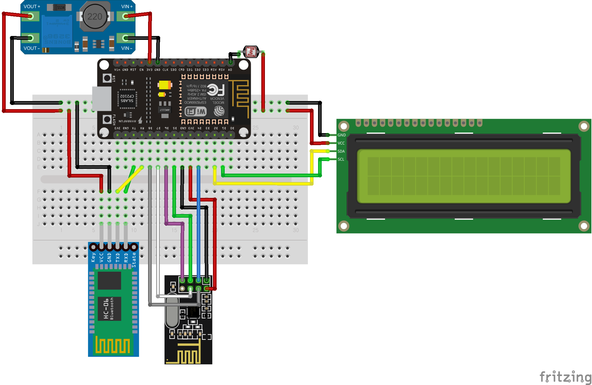

# NodeMCU 1.0 ESP8266 - 12E : pin information

# Circuit

# iot_test.ino를 위해 설치해야 하는 것
### 보드
[esp8266](https://github.com/esp8266/Arduino)
### 라이브러리
[Firebase Arduino Client Library for ESP8266 and ESP32](https://github.com/mobizt/Firebase-ESP-Client)